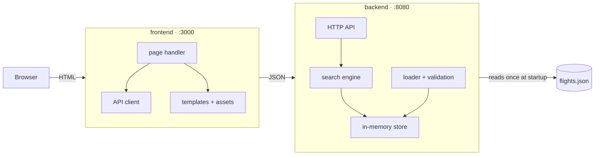

# SkyPath

[](https://github.com/luisalarcon/skypath/actions/workflows/ci.yml)

Flight connection search. Given an origin, a destination and a date, SkyPath finds every valid itinerary of up to two stops, with durations that are correct across time zones, daylight saving and the date line.

It is two small Go services with no third-party dependencies:

- **backend**: a versioned JSON API over an in-memory flight index
- **frontend**: a server-rendered web application that works with or without JavaScript

## Run it

```sh
git clone https://github.com/luisalarcon/skypath.git
cd skypath
docker-compose up
```

| | URL |
|---|---|
| Web application | http://localhost:3000 |
| API | `http://localhost:8080`, for example [`/readyz`](http://localhost:8080/readyz) |

`docker compose up` works too. If a port is taken: `FRONTEND_PORT=3001 BACKEND_PORT=8081 docker-compose up`.

The schedule covers departures on 2024-03-15 and 2024-03-16, and the date picker defaults to the first of them.

## Live demo

| | URL |
|---|---|
| Web application | https://skypath-4bl8.onrender.com |
| API | [`https://skypath-api-qmx4.onrender.com/readyz`](https://skypath-api-qmx4.onrender.com/readyz) |

The same two containers, unchanged, run on Render's free plan. Free services stop after about 15 minutes without traffic, so the first visit after a quiet spell can take about a minute while the page wakes, and the first search up to another minute while the API wakes. After that, responses are immediate. The frontend there allows 60 seconds for a call to the API (`BACKEND_TIMEOUT=60s`), so a cold start shows as a slow search rather than an error.

## Try these searches

| # | Search on 2024-03-15 | What you get |
|---|---|---|
| 1 | [JFK → LAX](http://localhost:3000/?origin=JFK&destination=LAX&date=2024-03-15) | 27 itineraries: 3 direct, 14 one-stop, 10 two-stop |
| 2 | [SFO → NRT](http://localhost:3000/?origin=SFO&destination=NRT&date=2024-03-15) | 6 itineraries. The connection at LAX is international, so the 90-minute minimum applies |
| 3 | [BOS → SEA](http://localhost:3000/?origin=BOS&destination=SEA&date=2024-03-15) | 13 itineraries, none direct |
| 4 | [JFK → JFK](http://localhost:3000/?origin=JFK&destination=JFK&date=2024-03-15) | Validation error: "Destination must be different from origin." |
| 5 | [XXX → LAX](http://localhost:3000/?origin=XXX&destination=LAX&date=2024-03-15) | Validation error: "Unknown airport code XXX." |
| 6 | [SYD → LAX](http://localhost:3000/?origin=SYD&destination=LAX&date=2024-03-15) | 2 direct flights of 15 hours that land at an earlier local time than they depart |

The same searches against the API:

```sh
curl 'http://localhost:8080/api/v1/search?origin=JFK&destination=LAX&date=2024-03-15'
```

These results are asserted by tests that run the whole backend through its HTTP API against the shipped schedule, and the first is checked again in CI against the running containers. See [Testing](#testing).

## How it works



**Loading.** At startup the backend reads `flights.json` once. Every record is validated; each local time is converted to an absolute instant in its airport's time zone; each price is parsed to whole cents. A record that cannot be trusted is skipped and reported, never repaired. The service does not open its port until this is done.

**Storing.** The validated flights live in memory, grouped by origin airport and sorted by departure. The store is never modified after it is built, so any number of requests read it at once with no locking.

**Searching.** The whole search needs one question answered: *which flights leave airport X at or after time T?* A binary search into the sorted list answers it. The engine takes the flights leaving the origin on the requested local date, then for each one asks the same question about where it lands, bounded by the legal layover window, up to three flights deep. It never looks at a flight outside a legal window.

**Serving.** The API validates input, runs the search and returns JSON. The frontend calls the API from the server and renders HTML, so the browser only ever talks to the frontend.

## Connection rules

| Rule | Implementation |
|---|---|
| Minimum layover: 45 min domestic, 90 min international | A connection is domestic only when all three airports involved are in one country. A domestic flight feeding an international one is an international connection. |
| Maximum layover: 6 hours | Both limits are inclusive: exactly 45, 90 or 360 minutes is allowed. |
| No airport changes | Connections match on airport code. JFK and LGA are different airports. |
| Time zones | Every time is an instant carrying its airport's IANA zone. Durations are plain subtraction. |
| At most two stops | The search stops at three flights and never revisits an airport. |

## What the data contained

The schedule was profiled before anything was designed. It holds 25 airports and 303 flight records, including several things that would quietly produce wrong answers:

| Found | Handling |
|---|---|
| Flight SP995 departs from `JKF`, which is not an airport in the file | Skipped, logged, and listed at [`/readyz`](http://localhost:8080/readyz). Not guessed to mean JFK. |
| Three prices are strings (`"289.00"`, `"99"`, `"95.00"`), others integers | Accepted. Parsed from text straight into cents. |
| Phoenix does not observe daylight saving | The IANA zone database decides, not a table of offsets. PHX → LAX is 30 minutes on this date. |
| The US is on daylight time on 2024-03-15; Europe is not | Same. |
| Flights that cross the date line land "before" they depart, or two calendar days later | Durations come from instants, so no special case exists. |
| 46 flight pairs are exactly 45 minutes apart, 103 exactly 90, 35 exactly 360 | The limits are inclusive, and a test proves the extremes appear in real results. |
| 24 pairs mix a domestic and an international flight 45 to 89 minutes apart | International minimum applies; they are rejected. |

## Design decisions

The full reasoning, including the options that were rejected, is in the [decision log](docs/decisions.md). The ones that shape the system:

**In-memory indexes rather than a database.** The schedule is 68 KB, read-only and loaded once. A database would add a dependency, a startup-ordering problem and a failure mode for nothing at this size. The search reads data through a two-method interface, so a database-backed store is a contained change when the data outgrows memory.

**Search per request over a sorted index.** Precomputing every connection, or every itinerary, would be faster still, but a search already inspects only a few hundred flights. Keeping the rules at query time keeps them in one place and leaves room for them to vary per search.

**Invalid records are skipped, not repaired.** Correcting `JKF` to `JFK` would invent a flight that may not exist and hide the problem from whoever owns the data. A reported skip keeps results correct and the problem visible.

**Instants, not offsets.** Times are converted once, at load, using the zone database compiled into the binary. No code anywhere adds or subtracts hours.

**Money as integer cents.** Floating point cannot represent most decimal fractions, so sums drift.

**Standard library only.** Go's standard library has the router, zone database, structured logging, templating and test server this needs. There is no dependency to audit or update.

**A server-rendered frontend.** One form and one list do not need a client-side framework. Every state renders on the server; a small script then adds in-place search, loading feedback and browser-side validation by fetching the same page and swapping regions, so there is exactly one rendering path.

**Contract first.** The API is specified in [`api/openapi.yaml`](api/openapi.yaml) with example payloads that both services test against. That contract is what allowed the backend and frontend to be built in parallel.

**A standard error format.** Errors are RFC 9457 problem documents with a stable `code` and one entry per invalid field, so a form can show every problem at once.

## Assumptions

Where the requirements left room, these readings were chosen:

1. The search date is the local date of the **first departure at the origin**. Later flights may leave the next day.
2. Layover limits are **inclusive**.
3. A connection is domestic only if **all three airports** share a country.
4. **Identical origin and destination** is a validation error, not an empty result.
5. An **unknown airport code** is a 400 with a message naming it.
6. An itinerary **never visits an airport twice**.
7. Results with equal travel time are ordered by **price, then departure**.
8. Prices add per flight; there are no through-fares. Currency is US dollars.
9. Minimum connection time does not vary by airport or terminal.

## Tradeoffs

- **Changing the schedule means rebuilding the image.** That is the cost of having no database and no volume.
- **Rules are re-evaluated on every search.** Cheap now; a precomputed connection graph is the next step for a larger network.
- **All itineraries are returned, unpaginated.** The largest result is 27. A larger network would need limits and paging.
- **The loading indicator needs JavaScript.** Without it the page still works, with the browser's own indicator.
- **The two services share no code.** Each has its own small middleware. The contract and its examples keep them in step instead.
- **A stopped backend can show as "took too long" under Docker.** Docker's internal DNS takes four to five seconds to report that a stopped service's name no longer exists, about as long as the frontend waits for the API (`BACKEND_TIMEOUT`, 5s). Whichever finishes first decides whether the page says "Search is temporarily unavailable" (502) or "The search took too long" (504). Either way the search stays filled in for a retry.

## Security

SkyPath serves public, read-only schedule data and stores nothing about its users. Security work therefore went into handling input safely and hardening the services, not into access control. **The API has no authentication and no rate limiting.**

**In place**

- Every input is validated before it is used: airport codes must be three letters and exist in the schedule, and dates must be ISO dates. Anything else is a 400 that names the field.
- An inbound `X-Request-ID` is accepted only if it is 1 to 64 letters, digits, `.`, `_` or `-`, so a client cannot write arbitrary text into the logs.
- Error responses never contain internal details. The cause is logged under the request ID.
- Explicit server timeouts for headers, reads, writes and idle connections, a deadline on every request, and recovery from panics.
- The API sends `X-Content-Type-Options: nosniff` and `Cache-Control: no-store`, and no CORS headers, so scripts on other sites cannot read it from a browser. The web application adds a strict content security policy (no inline script or style), `X-Frame-Options: DENY` and a referrer policy, and renders all input through `html/template`.
- Containers run as an unprivileged user on minimal images. There are no secrets in the code or configuration, and no third-party dependencies.

**Not covered, and what production would add**

| Gap | Next step |
|---|---|
| No authentication: anyone who can reach the API can search | Keep the API on a private network behind the frontend; issue API keys or OAuth tokens to any direct clients |
| No rate limiting: one client can send unlimited searches | Per-client limits at the edge (load balancer, gateway or CDN), or a token-bucket middleware in the API |
| No vulnerability scanning in CI | `govulncheck` for the Go toolchain and standard library, and an image scanner for the base images |
| TLS is left to the host | Fine behind a managed platform; terminate TLS at a proxy anywhere else |

## Testing

```sh
cd backend  && go test -race ./...
cd frontend && go test -race ./...
```

| Layer | What is proved |
|---|---|
| Domain | Money parsing and exact sums, dates, durations across zones and the date line |
| Loader | Every skip reason, record isolation, file-level failures, the shipped file (25 airports, 302 flights, 1 skipped) |
| Search | Every rule at its boundary (44/45/46, 89/90/91, 360/361), revisits, overnight and date-line cases, ordering; cross-checked against a brute-force search on a generated network |
| API | Every example payload in the contract, every validation rule, error mapping |
| **Whole backend** | Wired as in production, through HTTP, on the shipped schedule: the reference results above, plus every itinerary on all 600 routes and both dates (2,482 itineraries) checked against the rules |
| Frontend | The page state and status for every outcome, formatting, the API client against a fake server, every template state, escaping |

The reference results were produced by a separate implementation of the rules written while profiling the data, so the service is checked against an independent answer rather than against itself.

CI runs formatting, `go vet`, `staticcheck`, tests with the race detector, then builds the containers and searches through them.

On a generated network of 25 airports and 300 flights, a search takes about 3 to 4 µs and 4 allocations, averaged over every route in the network (about 1.7 itineraries per search).

## With more time

1. **Paging and filters in the API**: maximum stops, price ceiling, sort order.
2. **Sort and filter controls in the interface**, driven by the raw values already present on each card.
3. **A richer airport picker** with keyboard navigation and search by city name; today it is a native suggestion list.
4. **Nearby airports**: searching "New York" across JFK, LGA and EWR.
5. **Schedule reloading without a restart**, by building a new store and swapping a pointer.
6. **Metrics and tracing**; today there are structured logs with request IDs carried across both services.
7. **Result caching** keyed by route and date, valid until the schedule changes.
8. **Browser-level tests** of the script, which is currently verified by hand.
9. **Minimum connection times per airport**, which is how real schedules work.
10. **Authentication and rate limiting** for the API, as described under [Security](#security).

## How it was built

I built SkyPath with AI coding agents in Claude Code, using different models for different kinds of work and running independent parts in parallel. The [decision log](docs/decisions.md#how-the-project-is-built) records where I overruled the assistant and where it pushed back.

1. **Plan before code (about an hour).** With Claude Fable 5.2: profile the schedule, write an independent prototype of the search to produce reference results, then write the design documents and the API contract. No application code was written until the design was settled.
2. **Freeze the seams.** The domain types, the interfaces between packages, the OpenAPI contract and the frontend's view models were committed first, so parallel work could not drift apart.
3. **Build in parallel (about 35 minutes).** Five agents worked at the same time, each in its own git worktree and branch and owning only its own packages. A sixth built the containers and CI while the documentation was being written.

   | Part | Branch | Model |
   |---|---|---|
   | Data layer: loading, validation, in-memory store | `feat/backend-data` | Claude Opus |
   | Search engine and connection rules | `feat/backend-search` | Claude Opus |
   | HTTP API, middleware, configuration | `feat/backend-api` | Claude Sonnet |
   | Frontend server and API client | `feat/frontend-server` | Claude Sonnet |
   | Interface: templates, stylesheet, script | `feat/frontend-ui` | Claude Opus |
   | Dockerfiles, Compose, Makefile, CI | `chore/infrastructure` | Claude Sonnet |

   Opus took the parts where correctness or design judgement mattered most; Sonnet took the parts that follow a written contract closely.
4. **Integrate and verify.** Each branch was reviewed against its specification and merged by pull request only with CI green. The entry points were then wired together and the whole backend was tested through HTTP against the reference results. Review caught real defects, among them airport-code normalisation that accepted non-ASCII letters, and a client disconnect being logged as a server error.
5. **Final review in parallel.** Two more agents ran at once: one checked every requirement against the code (Claude Opus), the other followed this README from a fresh clone (Claude Sonnet).

From first reading the requirements to the merged README took about two hours; the final review and the deployment took about half an hour more. Because the streams committed at the same time, many commits in the history are minutes or seconds apart. Pull requests 1 to 10 show the order in which the parts landed.

## Project layout

```
api/            OpenAPI contract and canonical example payloads
backend/
  cmd/server    wiring and startup
  internal/
    flight      domain model: Airport, Flight, Itinerary, Money, Date
    dataset     read and validate the schedule
    store       in-memory indexes
    search      connection rules and the search
    api         HTTP handlers, validation, error format
    httpx       middleware
    config      settings
frontend/
  cmd/web       wiring and startup
  internal/     API client, page handler, view models, settings
  templates/    HTML templates
  static/       stylesheet and script
docs/           design documents
flights.json    the schedule
```

## Documentation

| Document | Contents |
|---|---|
| [Architecture](docs/architecture.md) | Services, request flow, package layout |
| [Data](docs/data.md) | The schedule file, validation, storage and indexes |
| [Search](docs/search.md) | Time model, connection rules and the algorithm |
| [API](docs/api.md) | Endpoints, validation and errors |
| [Frontend](docs/frontend.md) | Screens, states and visual design |
| [Testing](docs/testing.md) | Test strategy and reference results |
| [Operations](docs/operations.md) | Configuration, health, containers, deployment |
| [Decisions](docs/decisions.md) | Why it is built this way, and how it was built |
