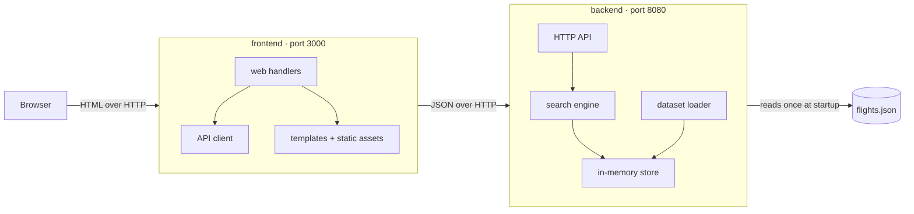

# Architecture

SkyPath answers one question: *how can I fly from A to B on this date?* It returns every valid itinerary of up to three flights, with correct durations across time zones.

It is two small Go services with no third-party dependencies.



## Services

| Service | Responsibility | Talks to |
|---|---|---|
| **backend** | Loads the schedule, answers itinerary searches as a versioned JSON API | nothing; the data is in memory |
| **frontend** | Renders the search page on the server and presents results | the backend API |

The browser only ever talks to the frontend. That keeps the API free of browser concerns such as CORS, and lets the page work with JavaScript turned off.

## Life of a search

1. The browser requests `/?origin=JFK&destination=LAX&date=2024-03-15` from the frontend.
2. The frontend calls `GET /api/v1/search` on the backend with the same three values.
3. The API layer validates the input and builds a query.
4. The search engine walks the flight index and collects every valid itinerary.
5. The API layer encodes the result as JSON.
6. The frontend converts the JSON into display values and renders the page.

Steps 3 to 5 touch only memory. Nothing in a request reads a file or a network resource on the backend.

## Backend packages

```
backend/
├── cmd/server        wiring: configuration, load data, start the HTTP server
└── internal/
    ├── flight        domain model: Airport, Flight, Itinerary, Money, Date
    ├── dataset       read and validate the schedule file
    ├── store         in-memory indexes over the validated data
    ├── search        connection rules and the itinerary search
    ├── api           HTTP handlers, validation, JSON shapes, error responses
    ├── httpx         middleware: request ID, access log, recovery, timeout
    └── config        settings from environment variables
```

**Dependency rules**

- `flight` depends on nothing inside SkyPath. Everything else may depend on it.
- `search` reads data only through its own `FlightSource` interface. It does not import `store` or `dataset`.
- `api` depends on its own `Searcher` and `AirportDirectory` interfaces. It does not import `search`, `store` or `dataset`.
- `cmd/server` is the only place that knows every package and connects them.

Because each layer names what it needs as a small interface, each can be tested alone: the search with a handful of hand-made flights, the API with a stub search.

| Package | Provides |
|---|---|
| `dataset` | `Load(path) (*Dataset, error)`, `Parse(io.Reader) (*Dataset, error)` |
| `store` | `New(airports, flights) *Store` with `Airport`, `Airports`, `DeparturesFrom`, `Len` |
| `search` | `NewEngine(FlightSource) *Engine` with `Search(ctx, flight.Query)` |
| `api` | `NewHandler(Dependencies) http.Handler` |
| `httpx` | middleware constructors and `Chain` |
| `config` | `Load() (Config, error)` |

## Frontend packages

```
frontend/
├── cmd/web           wiring: configuration, start the HTTP server
├── internal/
│   ├── view          view models: the contract between handlers and templates
│   ├── client        typed client for the backend API
│   ├── web           handlers, view-model mapping, formatting, security headers
│   └── config        settings from environment variables
├── templates         HTML templates, embedded in the binary
└── static            stylesheet and script, embedded in the binary
```

Templates receive `view` values and nothing else. Every user-visible string is formatted in Go before it reaches a template.

## Cross-cutting conventions

- **Standard library only.** Routing uses `net/http`, logging uses `log/slog`, templates use `html/template`.
- **Configuration** comes from environment variables with safe defaults, validated once at startup. See [operations.md](operations.md).
- **Logging** is structured JSON on standard output. Every request gets an ID that appears on each of its log lines and is passed from frontend to backend.
- **Errors** returned by the API follow the problem-details format. See [api.md](api.md).
- **Immutability.** Data is loaded once and never modified, so request handling needs no locks.
- **Time.** Every time is an absolute instant that carries its airport's zone. See [search.md](search.md).

## Further reading

- [data.md](data.md): the schedule file, validation, storage and indexes
- [search.md](search.md): time model, connection rules and the algorithm
- [api.md](api.md): endpoints and error catalogue
- [frontend.md](frontend.md): screens, states and design
- [testing.md](testing.md): test strategy and reference results
- [operations.md](operations.md): configuration, health, containers, deployment
- [decisions.md](decisions.md): why it is built this way
